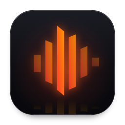
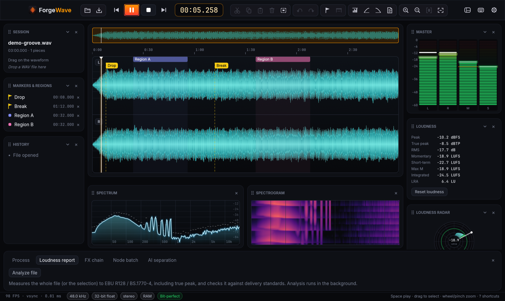
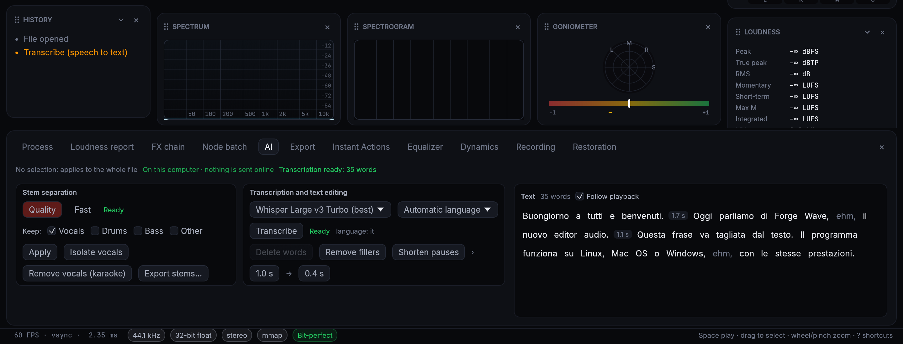
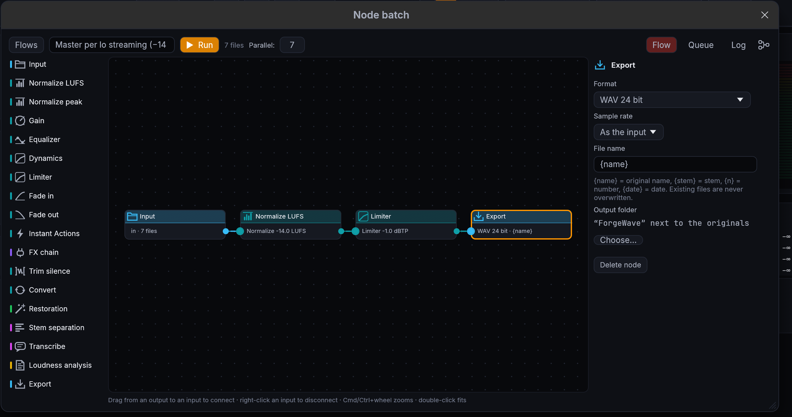
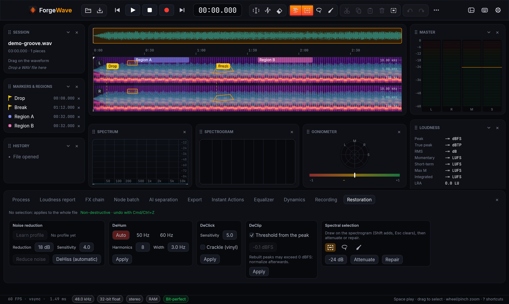
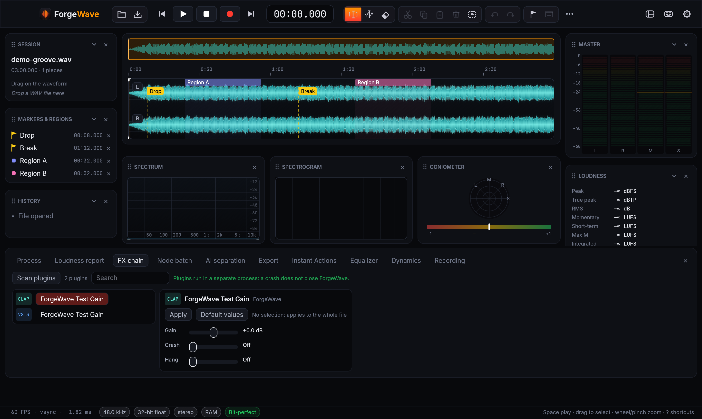
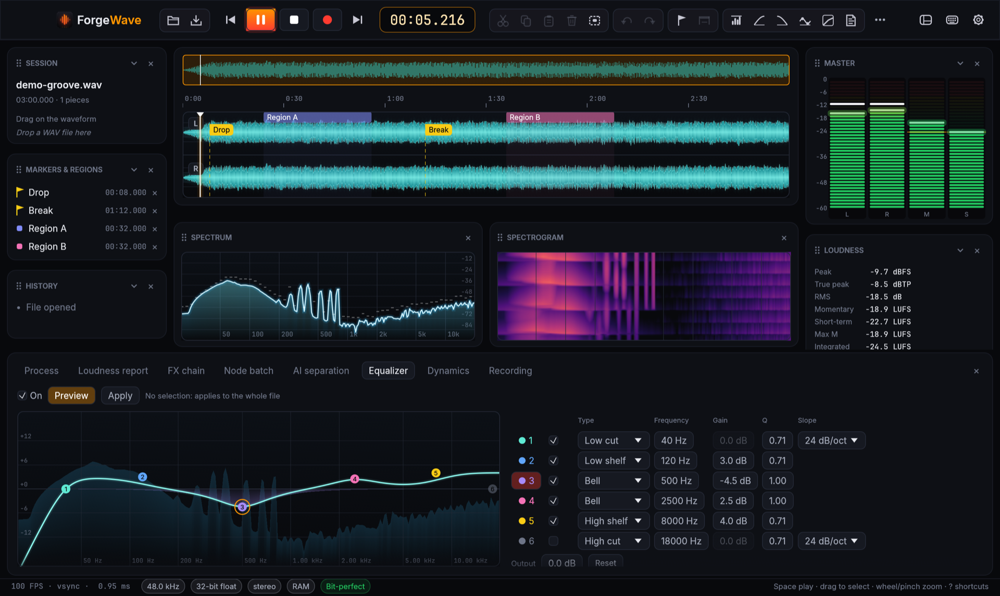
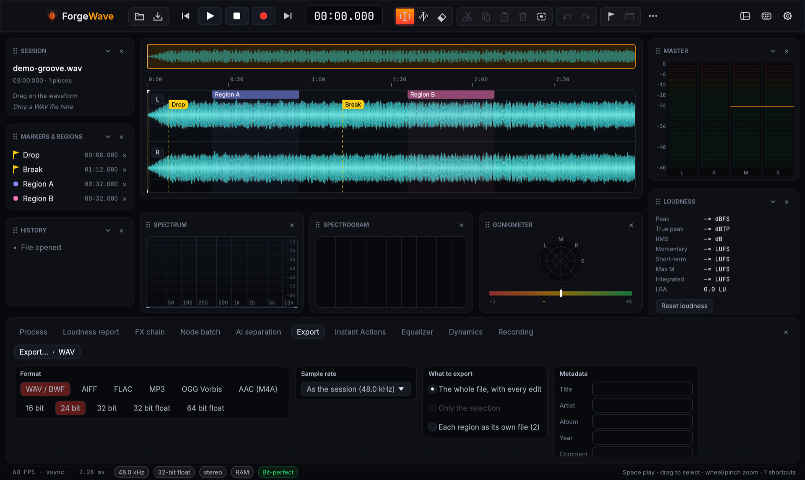

  

<h1 align="center">ForgeWave</h1>

<b>Professional audio wave editor</b> · editor audio professionale per macOS, Windows e Linux

  <a href="https://github.com/kikoz85/ForgeWave/releases/latest"><b>⬇︎ Scarica l'ultima versione / Download the latest version</b></a>

  
  
  

  <a href="#-italiano">🇮🇹 Italiano</a> · <a href="#-english">🇬🇧 English</a>

> **Beta pubblica / Public beta.** ForgeWave 0.9 è completo e provato su tutti e tre i sistemi, ma è ancora una beta: segnalaci i problemi nelle [Issues](https://github.com/kikoz85/ForgeWave/issues). / ForgeWave 0.9 is feature-complete and tested on all three systems, but it is still a beta: please report problems in the [Issues](https://github.com/kikoz85/ForgeWave/issues).

<table>
<tr><td></td><td></td></tr>
<tr><td align="center">IA locale · Local AI</td><td align="center">Batch a nodi · Node batch</td></tr>
<tr><td></td><td></td></tr>
<tr><td align="center">Spettrale e restauro · Spectral and restoration</td><td align="center">Plugin · Plugins</td></tr>
<tr><td></td><td></td></tr>
<tr><td align="center">EQ</td><td align="center">Export</td></tr>
</table>

---

## 🇮🇹 Italiano

ForgeWave è un editor audio **non distruttivo**, con la stessa resa e le stesse prestazioni su macOS, Windows e Linux. Apre file di ore all'istante, non tocca mai l'originale e ogni modifica si annulla.

### Cosa fa

- ⚡ **Editing istantaneo anche su file enormi**: tagli, incolla, marker e regioni; annulla e ripristina illimitati.
- 🎧 **Riproduzione bit-perfect**, scrub, meter, loudness EBU R128 con **report** per streaming, broadcast e podcast.
- 🎛️ **Processi**: normalizzazione di picco o LUFS, dissolvenze, **EQ a 6 bande**, **compressore e limiter true peak**, Instant Actions.
- 💿 **Mastering**: **compressore multibanda**, EQ e multibanda anche solo **Mid o Side**, **confronto A/B** con un brano di riferimento allineato in loudness, **assemblaggio dell'album** con pause, dissolvenze, loudness comune e foglio CUE.
- 📁 **Progetti**: salvi il lavoro e lo riprendi quando vuoi, con tutte le modifiche.
- 🔌 **Plugin CLAP, VST3, AU e LV2** in un processo separato: se un plugin va in crash, ForgeWave resta aperto.
- 🌈 **Editing spettrale** (spettrogramma, selezione tempo × frequenza, attenua e ripara) e **restauro**: riduzione del rumore, DeHiss, DeHum, DeClick, DeClip.
- 🤖 **IA locale, senza cloud**: **separazione degli stem** (voce, batteria, basso, altro), **trascrizione** con editing dal testo (cancelli le parole e l'audio si taglia) e **restauro con un clic**.
- 🧩 **Batch a nodi**: un flusso di nodi (LUFS, EQ, plugin, stem, sottotitoli, export…) su cartelle intere, in parallelo su tutti i core.
- 🎙️ **Registrazione** multicanale, anche dell'audio delle altre app e del sistema.
- 💾 **Export** in WAV/BWF/RF64, AIFF, FLAC, MP3, OGG, Opus, AAC.
- 🌍 Italiano, English, Français, Deutsch, Español, con la guida d'uso completa integrata.
- 🔄 **Aggiornamenti automatici**, firmati e verificati.

### Requisiti

- **macOS 13** o successivo (Apple Silicon o Intel) · **Windows 10/11** a 64 bit · **Linux** x86_64 con glibc 2.39 o successiva (Ubuntu 24.04, Debian 13, Fedora 40 e più recenti; PipeWire o ALSA)
- IA locale: 8 GB di RAM consigliati; su macOS serve un Mac con Apple Silicon (i modelli si scaricano a parte, solo se servono)

### Installazione

Scarica dalla pagina [Releases](https://github.com/kikoz85/ForgeWave/releases/latest) il file per il tuo sistema:

| Sistema | File | Come |
|---|---|---|
| macOS | `ForgeWave-x.y.z-macos-universal.dmg` | apri il DMG e trascina ForgeWave in **Applicazioni** |
| Windows | `ForgeWave-x.y.z-windows-x64-setup.exe` | installer per il tuo utente, senza amministratore (oppure lo `.zip`) |
| Linux | `ForgeWave-x.y.z-x86_64.AppImage` | rendilo eseguibile e aprilo (oppure il `.tar.gz` con `install.sh`) |
| Debian, Ubuntu | `forgewave_x.y.z_amd64.deb` | aprilo con l'installer dei pacchetti, oppure `sudo apt install ./forgewave_x.y.z_amd64.deb` |

- **macOS**, al primo avvio: se dice che non può verificare lo sviluppatore, apri **Impostazioni di Sistema › Privacy e sicurezza**, scorri in basso e premi **Apri comunque**.
- **Windows**: se SmartScreen mostra "Windows ha protetto il PC", premi **Ulteriori informazioni › Esegui comunque**.
- Gli aggiornamenti successivi arrivano dall'app (**Impostazioni › Generale › Aggiornamenti**): si installano solo se firmati con la chiave di ForgeWave e identici al file pubblicato. I file `SHA256SUMS*` e le loro firme `.sig` sono in ogni release. Chi ha installato il `.deb` si aggiorna installando il `.deb` nuovo.

### Licenza

ForgeWave è **gratuito**, anche per uso professionale e commerciale, ed è fornito così com'è, senza garanzie: i termini sono in [`LICENSE.txt`](LICENSE.txt). I componenti open source e il testo completo delle loro licenze sono in [`THIRD_PARTY_LICENSES.md`](THIRD_PARTY_LICENSES.md) e nell'app (**Impostazioni › Informazioni**). L'export MP3 usa LAME (LGPL), una libreria separata e sostituibile: sorgente e istruzioni sono in [`lame/`](lame).

### Privacy

L'audio resta sul tuo computer: l'IA gira in locale e i modelli si scaricano una volta da Hugging Face. L'unico collegamento a internet, oltre ai download dei modelli che chiedi tu, è il controllo della versione su GitHub (disattivabile).

---

## 🇬🇧 English

ForgeWave is a **non-destructive** audio editor with the same look and performance on macOS, Windows and Linux. It opens hour-long files instantly, never touches the original and every edit can be undone.

### What it does

- ⚡ **Instant editing, even on huge files**: cut, paste, markers and regions; unlimited undo and redo.
- 🎧 **Bit-perfect playback**, scrubbing, meters, EBU R128 loudness with **reports** for streaming, broadcast and podcasts.
- 🎛️ **Processing**: peak or LUFS normalization, fades, **6-band EQ**, **compressor and true-peak limiter**, Instant Actions.
- 💿 **Mastering**: **multiband compressor**, EQ and multiband also on **Mid or Side** only, **A/B comparison** with a loudness-matched reference track, **album assembly** with pauses, crossfades, common loudness and CUE sheet.
- 📁 **Projects**: save your work and pick it up whenever you like, with every edit.
- 🔌 **CLAP, VST3, AU and LV2 plugins** in a separate process: if a plugin crashes, ForgeWave stays open.
- 🌈 **Spectral editing** (spectrogram, time × frequency selection, attenuate and repair) and **restoration**: noise reduction, DeHiss, DeHum, DeClick, DeClip.
- 🤖 **Local AI, no cloud**: **stem separation** (vocals, drums, bass, other), **transcription** with text-based editing (delete words and the audio is cut) and **one-click restoration**.
- 🧩 **Node batch**: a flow of nodes (LUFS, EQ, plugins, stems, subtitles, export…) on whole folders, in parallel on every core.
- 🎙️ Multichannel **recording**, including other apps' and system audio.
- 💾 **Export** to WAV/BWF/RF64, AIFF, FLAC, MP3, OGG, Opus, AAC.
- 🌍 English, Italiano, Français, Deutsch, Español, with a complete built-in user guide.
- 🔄 **Automatic updates**, signed and verified.

### Requirements

- **macOS 13** or later (Apple Silicon or Intel) · 64-bit **Windows 10/11** · x86_64 **Linux** with glibc 2.39 or later (Ubuntu 24.04, Debian 13, Fedora 40 and newer; PipeWire or ALSA)
- Local AI: 8 GB of RAM recommended; on macOS it needs a Mac with Apple Silicon (models are downloaded separately, only when needed)

### Installation

Download the file for your system from the [Releases](https://github.com/kikoz85/ForgeWave/releases/latest) page:

| System | File | How |
|---|---|---|
| macOS | `ForgeWave-x.y.z-macos-universal.dmg` | open the DMG and drag ForgeWave into **Applications** |
| Windows | `ForgeWave-x.y.z-windows-x64-setup.exe` | per-user installer, no administrator needed (or the `.zip`) |
| Linux | `ForgeWave-x.y.z-x86_64.AppImage` | make it executable and open it (or the `.tar.gz` with `install.sh`) |
| Debian, Ubuntu | `forgewave_x.y.z_amd64.deb` | open it with the package installer, or `sudo apt install ./forgewave_x.y.z_amd64.deb` |

- **macOS**, first launch: if it says the developer cannot be verified, open **System Settings › Privacy & Security**, scroll down and press **Open Anyway**.
- **Windows**: if SmartScreen shows "Windows protected your PC", press **More info › Run anyway**.
- Later updates come from the app (**Settings › General › Updates**): they are installed only if signed with ForgeWave's key and identical to the published file. The `SHA256SUMS*` files and their `.sig` signatures are in every release. If you installed the `.deb`, update by installing the new `.deb`.

### Licence

ForgeWave is **free**, including for professional and commercial use, and is provided as is, without warranty: the terms are in [`LICENSE.txt`](LICENSE.txt). Open-source components and the full text of their licences are in [`THIRD_PARTY_LICENSES.md`](THIRD_PARTY_LICENSES.md) and in the app (**Settings › About**). MP3 export uses LAME (LGPL), a separate, replaceable library: source and build instructions are in [`lame/`](lame).

### Privacy

Your audio stays on your computer: the AI runs locally and the models are downloaded once from Hugging Face. The only other connection, besides the model downloads you ask for, is the version check on GitHub (can be turned off).

---

© 2026 Enrico Fanucchi · <a href="https://www.enricofanucchi.com">www.enricofanucchi.com</a> · <a href="LICENSE.txt">Licence</a> · <a href="THIRD_PARTY_LICENSES.md">Third-party licences</a>

